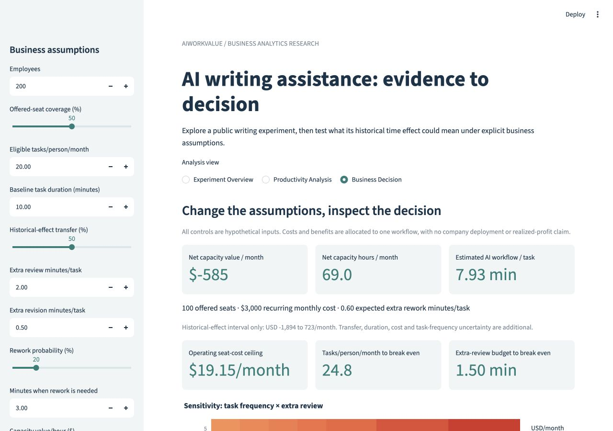
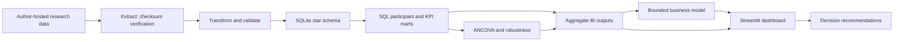
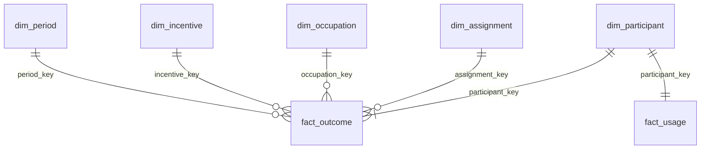

# AIWorkValue

**From public experimental evidence to a reproducible business intelligence decision.**

[Research report](reports/AIWorkValue_Research_Report.pdf) · [Dashboard guide](dashboard/README.md) · [SQL findings](reports/SQL_Analysis.md) · [Executed notebook](notebooks/01_experiment_to_business.ipynb) · [Executive recommendations](reports/Executive_Memo.md)

[](LICENSE)
[](https://github.com/Simon-Yu-analytics/AIWorkValue/actions/workflows/ci.yml)

## Business problem

An AI writing tool can shorten a task without paying for itself. A decision needs evidence about quality, suitable task volume, output checking and recurring costs. AIWorkValue reanalyzes a public writing experiment and connects the results to a **bounded, explicitly hypothetical** workflow model.

**Technical stack:** Python · SQL/SQLite · dimensional data modeling · pandas/NumPy · statsmodels/SciPy · Streamlit/Plotly · unittest/AppTest · GitHub Actions.

## Key findings and decision value

| Evidence | Result | What it supports |
|---|---:|---|
| Retained sample | 453 participants | Audited reconstruction of the original public data |
| Adjusted completion time | −10.34 minutes; 95% CI −12.58 to −8.10; N=346 | Faster historical writing-task completion among retained available cases |
| Adjusted writing quality | +0.70 points on a 1–7 scale; 95% CI +0.47 to +0.93; N=352 | Better rated writing, not proven factual accuracy |
| Exploratory moderation | Larger quality gains at lower baseline writing scores; time interaction imprecise | A task-score pattern to investigate, not an employee ranking |
| Business interpretation | Costs can outweigh usable time value | Measure full checking/rework time and eligible volume before purchasing |

The original experiment was conducted by **Shakked Noy and Whitney Zhang**. This project is an independent reanalysis and BI implementation, not a new randomized experiment, real company deployment or measured-profit claim. The original primary estimates and robustness results were preserved during the BI upgrade.

## Interactive dashboard

Run `make dashboard` after installing the requirements; open the printed local URL, normally `http://127.0.0.1:8501`. The app works from committed **aggregate** outputs without downloading participant data.

- **Experiment Overview:** sample flow, assigned groups, occupation-filtered descriptive comparisons and warehouse integrity.
- **Productivity Analysis:** adjusted effects, confidence intervals, robustness and exploratory baseline-score contrasts.
- **Business Decision:** change task duration, frequency, review, revision, rework probability/time and costs; inspect updated capacity value, break-even boundaries and sensitivity.



The [dashboard guide](dashboard/README.md) describes controls and hosting. GitHub stores the app source; it does not run the Python server. No public hosted URL is claimed.

## Technical architecture



The [ETL contract](docs/PIPELINE.md) is Extract → Transform → Validate → Load → Analyze. It reuses the original source cleaning, loads a validated snapshot atomically, and fits the statistical models from the SQL participant mart. Repeated runs replace the snapshot rather than append records.

## Star schema and SQL analytics



**Grain:** `fact_outcome` has one participant × baseline/post record (906 rows); `fact_usage` has one participant record (453 rows). Five dimensions provide identity, assignment, occupation, incentive and measurement period. [Full schema, keys and metric rules](docs/DATA_MODEL.md).

SQL performs dimensional loading, wide-to-long transformation, paired-outcome pivoting, aggregation and existing CTE/window/self-join analyses. The participant mart is reduced to one row per participant before usage is joined. Unique keys, foreign keys, row-count checks and Python/mart equality guard against duplicate statistics.

| Question | SQL example |
|---|---|
| How are dimensions, facts and marts built? | [Warehouse transformation](sql/warehouse/02_transform.sql) |
| Could a join inflate the measures? | [Grain and JOIN integrity](sql/warehouse/03_integrity.sql) |
| How much usable outcome data is available? | [Conditional coverage](sql/02_group_coverage.sql) |
| Are observed baseline results comparable? | [Baseline balance self-join](sql/03_baseline_balance.sql) |
| How do complete pairs change? | [Paired changes](sql/04_paired_changes.sql) |
| Which assumptions cover recurring costs? | [Business cases](sql/07_business_scenarios.sql), [break-even boundaries](sql/08_break_even.sql) |
| What does another checking minute change? | [Window-based sensitivity](sql/09_sensitivity_grid.sql) |

See [SQL findings](reports/SQL_Analysis.md), [warehouse aggregate audit](reports/warehouse-summary.json) and the [query guide](sql/README.md). SQL arithmetic is reconciled with Python for three named cases, 36 sensitivity points and nine email-task cases.

## Research and business model

The core models adjust post-task outcomes for their own baseline, occupation × randomized task order and incentive arm. They use HC3 robust t intervals and Holm adjustment for two primary outcomes. An independent matrix calculation checks covariance, intervals and model rank. [Research validation](reports/Research_Validation.md).

Baseline-performance moderation is explored with continuous interactions and pointwise contrasts at baseline-score quartiles. A single noisy writing score and the quality-scale ceiling limit interpretation; subgroup results remain exploratory. Actual AI use is not a primary sample filter or control.

The [weekly status-email extension](reports/extensions/Weekly_Status_Email.md) keeps one concrete business case. It compares task frequency and checking effort while adding an assumed **10-minute baseline**, **0.5-minute revision** and **20% probability of 3-minute rework**. Gross transferred savings cannot exceed the baseline task duration. Incremental review, revision and expected rework are then deducted.

Under those assumptions, weekly-only use with one extra checking minute gives about **−$2,284/month** of net capacity value across 100 offered seats; 20 suitable tasks with the same checking gives about **+$581/month**. Full seat/support costs are allocated to the workflow. These are conditional capacity values, not profit or actual savings. [Inputs and exact calculations](data/scenarios/weekly_status_email.json).

## Reproduce

Use Python 3.12+ from the repository root:

```bash
git clone https://github.com/Simon-Yu-analytics/AIWorkValue.git
cd AIWorkValue
python3 -m venv .venv
source .venv/bin/activate
python -m pip install -r requirements.txt
make check       # tests and committed-output validation; no research download
make dashboard   # interactive aggregate-only application
```

Full rebuild:

```bash
make download    # author-hosted files + recorded SHA-256 verification
make run         # ETL, warehouse, SQL, models, task extension, research checks
make report      # figures and PDF
make notebook    # executed walkthrough
make check
make package     # source + aggregates; raw/participant data excluded
```

No paid model API, GPU, Stata license or paid BI software is required. Dependency/source downloads require internet access. [Pipeline commands and behavior](docs/PIPELINE.md).

## Validation and limitations

Tests cover repeated loads, duplicate IDs, invalid foreign keys, fact grain, bad-reload protection, missing outcomes, capped savings, rework, SQL/Python agreement and all three Streamlit views. CI runs offline checks against fixtures and committed aggregates; the full real-source rebuild is also verified locally. Fixture records are software tests, not research evidence.

The experiment studied short writing tasks in early 2023. Completion differences and source exclusions limit full-sample intention-to-treat claims. Quality ratings are not factual audits or whole-job productivity. Financial ranges propagate historical effect uncertainty only; transferability, workflow assumptions and costs remain uncertain. No real outcomes were altered to make findings more attractive.

Source: Noy and Zhang (2023), [Science, DOI 10.1126/science.adh2586](https://doi.org/10.1126/science.adh2586), [author replication package](https://osf.io/xd7qw/). Raw data and participant-level warehouse files remain local because the source OSF node declared no license in its metadata when inspected. [Data policy](data/README.md) · [Methods](docs/DATA_AND_METHODS.md) · [Third-party notices](THIRD_PARTY_NOTICES.md).

## Project contribution

**Junhui (Simon) Yu — AIWorkValue portfolio project.** The repository contributes source reconstruction, dimensional modeling, ETL, SQL analytics, independent statistical checks, business modeling and an interactive BI app. AI tools assisted implementation and drafting; the original experiment and data collection belong to the cited researchers. [Project scope](docs/PROJECT_SCOPE.md) · [Walkthrough](docs/WALKTHROUGH.md).

Original project code and documentation use the [MIT License](LICENSE).
