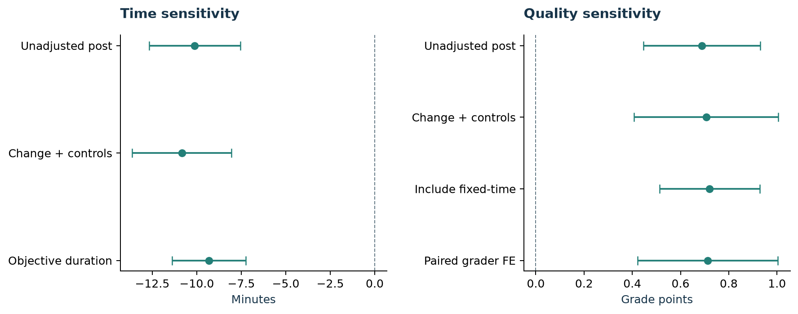
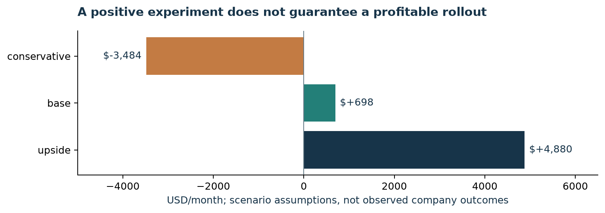

# AIWorkValue

[**Read the 10-page research report →**](reports/AIWorkValue_Research_Report.pdf) · [Executive decision memo](reports/Executive_Memo.md) · [Explore the executed notebook](notebooks/01_experiment_to_business.ipynb) · [Research card](docs/RESEARCH_CARD.md)

[](https://github.com/Simon-Yu-analytics/AIWorkValue/actions/workflows/ci.yml)

**A business analytics research project connecting generative AI's effects on writing time and quality to an enterprise adoption decision.**

AIWorkValue examines a practical investment question: **when does an AI writing tool create enough usable capacity to justify its cost?** It combines an independent reanalysis of a public randomized experiment with a transparent commercial extension.

The repository includes a reconstructed 453-participant sample, baseline-adjusted statistical models, robustness and heterogeneity analysis, SQL summaries, an executed notebook, eight reproducible figures, a 10-page report, seven Python tests and an automated offline quality gate.

The original experiment and data collection were conducted by **Shakked Noy and Whitney Zhang**. This project's contribution is independent reanalysis, method comparison and business interpretation. Commercial scenarios are explicitly hypothetical.

## Portfolio highlights

- **Decision focus:** translate task-level evidence into a conditional budget, including verification effort, eligible task volume and rollout costs.
- **Evaluation discipline:** preserve randomized assignment, distinguish model denominators, report robust intervals and compare reasonable alternative estimators.
- **Reproducible delivery:** hash-verified source downloads, a sample-flow audit, Python and SQL, executed analysis, a visual report and offline checks.

## Contents

- [Why this question matters](#why-this-question-matters)
- [Research-to-decision workflow](#research-to-decision-workflow)
- [Research snapshot](#research-snapshot)
- [Visual analysis and report](#visual-analysis-and-report)
- [Technical decisions](#technical-decisions)
- [What is implemented](#what-is-implemented)
- [Commercial decision](#commercial-decision)
- [Reproduce the project](#reproduce-the-project)
- [Repository layout](#repository-layout)
- [Data source and attribution](#data-source-and-attribution)
- [Assumptions and limitations](#assumptions-and-limitations)
- [Analytical takeaways](#analytical-takeaways)
- [Next research step](#next-research-step)

## Why this question matters

A company can observe that AI helps with a writing task and still make a poor investment decision. The task may represent only a small part of an employee's work. Checking the output can consume the apparent saving. A subscription creates a recurring cost even when a seat is rarely used.

This project separates the historical experimental effect from the assumptions needed to apply it in a new company. Its central output is a recommendation about what to measure before scaling an investment.

The methods stay within an explainable scope: Python, SQL, regression, uncertainty intervals and scenario analysis. The emphasis is on experimental reasoning and commercial judgment.

## Research-to-decision workflow

```text
Author-hosted experimental data + source documentation
                         |
                         v
Hash checks --> consent / completion / duplicate / quality audit
                         |
                         v
Map counterbalanced tasks --> baseline + post-task outcomes
                         |
                         v
Assigned AI access vs control --> adjusted time + quality effects
                         |                         |
                         |                         +--> robustness / attrition checks
                         v
Eligible tasks + transferability + verification effort + costs
                         |
                         v
Capacity value / break-even budget / downside scenarios
                         |
                         v
A bounded company pilot with explicit decision criteria
```

## Research snapshot

The pipeline reconstructs **453 retained participants** from the public replication materials. The primary non-fixed-time arms contain 359 people; missing baseline/post pairs produce separate outcome denominators.

| Evidence | Result | Interpretation |
|---|---:|---|
| Retained sample | 453 participants | Reconstructed with a numbered exclusion audit |
| Primary incentive arms | 359 participants | Fixed-time arm excluded from the primary productivity comparison |
| Adjusted completion time | **−10.34 minutes** | 95% interval −12.58 to −8.10; N=346 |
| Adjusted writing quality | **+0.70 points** | 1–7 rating scale; 95% interval +0.47 to +0.93; N=352 |
| Primary inference | Both Holm-adjusted p < 0.001 | Two co-primary tests; HC3 robust uncertainty |
| Commercial base scenario | **+$698/month** | Hypothetical net capacity value under documented assumptions |
| Time-effect uncertainty in that scenario | **−$610 to +$2,007/month** | Statistical effect uncertainty only; business assumptions remain uncertain |

The estimates compare **assigned access/onboarding**, not a selected group of people who chose to use AI. They apply to retained available cases. Completion differences and exclusions limit a full-sample intention-to-treat interpretation.

## Visual analysis and report

The **[10-page research report](reports/AIWorkValue_Research_Report.pdf)** moves from study design and sample reconstruction to effects, robustness, heterogeneity, adoption and the commercial decision. Eight figures are documented in the [figure gallery](figures/README.md).

| Experimental evidence | Business interpretation |
|---|---|
|  |  |
|  |  |

Each chart answers a decision question. Statistical intervals describe uncertainty in the historical estimate; commercial scenario ranges answer a different question about assumptions in a new setting.

## Technical decisions

| Decision | Implementation | Reason |
|---|---|---|
| Preserve the experiment | Analyze randomized assignment | Actual AI use is a post-assignment choice and would create a selected comparison |
| Map the task order | Use randomized A/B order to construct pre/post outcomes | Task A is not always the baseline task |
| Adjust for baseline | ANCOVA with occupation × task order and incentive controls | Compare post-task outcomes while accounting for baseline and design variables |
| Quantify uncertainty | HC3 robust t intervals; Holm adjustment for two primary tests | Report magnitude and uncertainty alongside significance |
| Aggregate writing ratings | Participant mean of paired eligible grader ratings | Keep the primary model explainable; test a grader fixed-effect alternative |
| Challenge the estimate | Change scores, log time, page duration, alternative quality samples | Check whether the direction depends on one estimator or measurement |
| Translate to business | Explicit capacity-value model with verification and cost | Prevent a task-level time saving from becoming an unsupported profit claim |

The [research card](docs/RESEARCH_CARD.md) summarizes intended use and evidence boundaries. The [data and methods protocol](docs/DATA_AND_METHODS.md) records the cleaning and estimator choices in detail.

## What is implemented

### 1. Data reconstruction and audit

- Download nine author-hosted replication assets and verify SHA-256 hashes.
- Reconstruct consent, completion, unique submissions, documented quality flags and prior-grader exclusions.
- Read only the analysis columns needed; original essay text and unrelated survey responses are not exposed in outputs.
- Map counterbalanced tasks, self-reported minutes, page durations and paired human ratings.
- Save participant-level CSV and SQLite files locally; publish aggregate summaries only.

### 2. Experimental reanalysis

- Estimate baseline-adjusted time and writing-quality assignment contrasts.
- Report robust standard errors, 95% intervals, analytic N and multiplicity-adjusted primary p-values.
- Compare eight sensitivity specifications, including paired-grader fixed effects with participant-clustered uncertainty.
- Explore baseline writing-score interactions and describe two-week self-reported adoption with response denominators.

### 3. Commercial extension

- Model offered-seat coverage, task frequency, transferability, verification effort, hourly capacity value and recurring costs.
- Calculate monthly net capacity value, an operating seat-cost ceiling and conditional setup-cost payback.
- Preserve conservative and negative-value scenarios.
- Propagate statistical time-effect uncertainty separately from uncertain business assumptions.

### 4. Reproducible communication

- Executed, editable [notebook](notebooks/01_experiment_to_business.ipynb) covering sample checks, SQL, regression and scenarios.
- English report and [executive memo](reports/Executive_Memo.md).
- [Chinese learning and interview guide](docs/中文学习与答辩指南.md) for understanding and personally extending the analysis.
- Seven focused mathematical tests, artifact validation and GitHub Actions checks without participant-data downloads.

## Commercial decision

The base case assumes 200 employees, 50% offered-seat coverage, 20 eligible tasks per offered employee/month, 50% transfer of the historical time effect, two additional verification minutes/task, $35/hour capacity value, an assumed $25/seat/month, $500 fixed monthly cost and $3,000 setup.

This yields about **105.7 released capacity hours/month** and **$698/month net capacity value**, with an operating seat-cost ceiling of **$31.98/month**. At these assumptions, verification overhead above approximately **2.60 minutes/task** removes the positive operating case.

**Recommendation:** fund a bounded writing-workflow pilot. Measure total time to accepted output, blinded quality, verification and rework, eligible task volume, offered-seat usage and real costs before committing to broad rollout. Released capacity needs a concrete use; it does not automatically reduce cash expenditure.

The seat cost is an illustrative assumption, not a vendor quote. The assignment effect already includes source-study take-up, so the model does not multiply it by that take-up rate again.

## Reproduce the project

Use Python 3.12+ from the repository root:

```bash
git clone https://github.com/Simon-Yu-analytics/AIWorkValue.git
cd AIWorkValue
python3 -m venv .venv
source .venv/bin/activate
python -m pip install -r requirements.txt
make check
```

`make check` runs seven focused tests and validates the committed aggregate results, executed notebook, figures and report. It does not require the original participant data. Dependency installation requires internet access.

To rebuild from the original research materials:

```bash
make download   # download source files and verify recorded hashes
make run        # reconstruct the sample, fit models and run SQL
make report     # regenerate eight figures and the 10-page PDF
make notebook   # regenerate and execute the walkthrough
make check
make package    # create a source-and-aggregate ZIP with checksums
```

The initial source download requires internet access. No model API, paid AI subscription, GPU or Stata license is needed. The notebook can also be run interactively in a Jupyter-capable editor with `ipykernel` installed into the same environment.

## Repository layout

```text
AIWorkValue/
├── .github/workflows/ci.yml       automated offline quality gate
├── data/
│   ├── README.md                  provenance and local-data policy
│   └── source-manifest.json       author URLs, byte counts and SHA-256 hashes
├── docs/
│   ├── RESEARCH_CARD.md           intended use, estimands and limits
│   ├── ANALYSIS_PLAN.md           declared analysis choices
│   ├── DATA_AND_METHODS.md        sample reconstruction and variables
│   └── 中文学习与答辩指南.md       ownership, extensions and interview preparation
├── figures/                       eight reproducible decision visualizations
├── notebooks/                     executed research walkthrough
├── reports/
│   ├── AIWorkValue_Research_Report.pdf
│   ├── Executive_Memo.md
│   ├── results.json               statistical and commercial aggregate outputs
│   ├── data-audit.json            numbered sample flow
│   └── sql-summaries.json         aggregate SQL tables
├── scripts/                       download, analysis, reporting and packaging
├── sql/study_analysis.sql         descriptive analysis queries
├── src/aiworkvalue/               reconstruction, estimation and value model
├── tests/                         seven mathematical and boundary checks
├── LICENSE
├── THIRD_PARTY_NOTICES.md
├── Makefile
└── README.md
```

## Data source and attribution

Source: Shakked Noy and Whitney Zhang (2023), [*Experimental evidence on the productivity effects of generative artificial intelligence*](https://doi.org/10.1126/science.adh2586), Science 381, 187–192. [Author-hosted replication package](https://osf.io/xd7qw/).

The experiment ran in early 2023. Source IDs were anonymized by the authors. The source OSF node declared no license in its metadata when inspected, so raw materials and participant-level derivatives are downloaded separately and excluded from Git and the project archive. The [source manifest](data/source-manifest.json) records exact files and hashes. See [third-party notices](THIRD_PARTY_NOTICES.md).

The [analysis plan](docs/ANALYSIS_PLAN.md) was written before this project's model estimation, with the original published findings already known. It is not a new preregistration. The primary quality estimator deliberately differs from the paper's full specification; the project documents the difference and adds a grader fixed-effect sensitivity check.

## Assumptions and limitations

- Retained available-case assignment contrasts do not remove differential completion or later sample-selection concerns.
- Short professional-writing tasks and selected occupations do not establish whole-job productivity or transfer to a specific company.
- Human writing ratings do not establish factual accuracy, compliance or customer outcomes.
- Early-2023 technology is historical evidence, not a current-model benchmark.
- Baseline writing-score heterogeneity is exploratory and cannot support employee rankings or employment decisions.
- Follow-up adoption is self-reported among respondents; nonresponse limits generalization.
- Commercial inputs are hypothetical. The financial interval propagates only statistical time-effect uncertainty and is not a full confidence interval for company profit.
- This project did not conduct the original experiment, deploy tools in a company or measure realized savings.

## Analytical takeaways

- A credible comparison starts with the assignment and sample construction, before choosing a regression model.
- Faster task completion and better writing ratings are separate outcomes with separate units and denominators.
- A positive experimental effect can coexist with a fragile commercial case when transferability and verification costs are uncertain.
- A clear business recommendation can be to collect a specific missing measurement before scaling an investment.

## Next research step

Use the historical result to design a small company pilot for a specific recurring writing task. Specify a quality rubric and measure time through checking and rework. Compare the observed eligible task volume and actual cost with the scenario model. Document any new data and distinguish it from the original public experiment.

## Author

**Junhui (Simon) Yu** — AIWorkValue portfolio project.

Original experiment: **Shakked Noy and Whitney Zhang**. Original project code and documentation are released under the [MIT License](LICENSE); source research materials retain their original rights.
