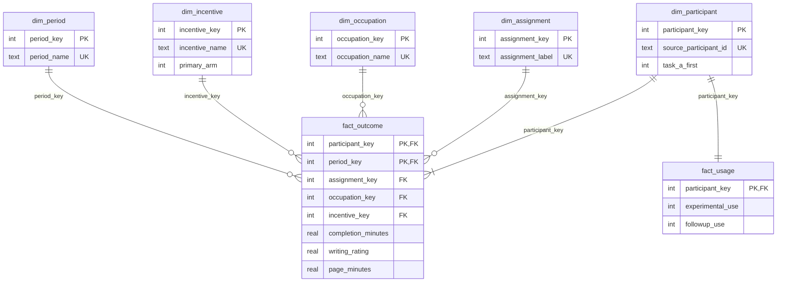

# Analytical warehouse and grain contract

SQLite is used for a small, local research warehouse. The model demonstrates dimensional design, SQL transformations and BI aggregation without pretending that a 453-person experiment needs a distributed production platform. Participant identifiers and the database stay local; only aggregate outputs are distributed.

## Grain and measures

| Table | Grain / key | Current snapshot | Meaning |
|---|---|---:|---|
| `dim_participant` | One retained source ID; unique natural key | 453 | Stable local identity and randomized task-order attribute |
| `dim_assignment` | Assigned group | 2 | Control / AI offer; actual use is not a dimension filter |
| `dim_occupation` | Source occupation | 6 | Descriptive grouping |
| `dim_incentive` | Source incentive arm | 3 | Linear/convex primary arms; fixed-time arm retained separately |
| `dim_period` | Measurement stage | 2 | Baseline / post, after randomized task-order mapping |
| `fact_outcome` | Participant × period; composite primary key | 906 | Completion minutes, mean writing rating, page duration; missing outcomes stay NULL |
| `fact_usage` | Participant; primary key also foreign key | 453 | Experimental and follow-up reported use; missing response stays NULL |

Outcome minutes are additive only across disjoint participant/period sets with known completeness. Writing ratings are not additive performance measures: use an observation-count-weighted mean when combining aggregate cells. A fact row containing NULL is not a zero outcome. Baseline plus post rows must not be described as twice as many participants.

## SQL transformation and marts

1. Python reconstructs the source sample and creates a temporary `stg_participant` table.
2. [Schema](../sql/warehouse/01_schema.sql) defines unique dimension keys, composite fact keys, foreign keys and range constraints.
3. [Transformation](../sql/warehouse/02_transform.sql) loads dimensions and uses `UNION ALL` to create baseline/post facts.
4. `mart_participant` pivots the outcome fact to one row per participant **before** joining the one-row-per-participant usage fact. The `participants` compatibility view preserves the existing SQL analyses.
5. `mart_experiment_kpi` aggregates assignment × occupation × period for the public dashboard. The dashboard uses only this exported aggregate snapshot and statistical JSON.

## Avoiding duplicate statistics

Dimension natural keys are UNIQUE and dimension surrogate keys are primary keys. Fact-to-dimension joins must preserve the outcome row count. The participant mart must have exactly one row per participant and exactly match the cleaned Python variables, including missing values.

A direct self-join of `fact_outcome` using only `participant_key` produces four rows per participant because each side has two periods. Do not aggregate that result. Specify period roles or pre-aggregate to the required grain first. [Integrity SQL](../sql/warehouse/03_integrity.sql) and warehouse tests explicitly check this risk, foreign-key coverage, period completeness and stable assignment across periods.

## Load behavior and boundaries

The loader validates inputs, builds a separate SQLite snapshot, checks foreign keys and mart round-trip equivalence, then atomically replaces the prior database. Reruns rebuild rather than append, so duplicate records do not accumulate. Invalid input does not replace the prior valid snapshot. Staging is removed after loading.

This is a single-source snapshot model, not a claim of cloud warehouse deployment, change-data capture, production orchestration or company-scale operating performance. See [pipeline design](PIPELINE.md), [warehouse aggregate audit](../reports/warehouse-summary.json) and [SQL guide](../sql/README.md).
