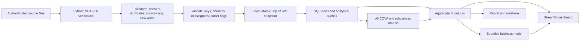

# ETL and analysis pipeline



The executable stage contract is **Extract → Transform → Validate → Load → Analyze**. Both statistical models and warehouse marts use the same reconstructed sample. Source files remain separate from distributable aggregate outputs.

| Stage | Implementation | Failure / validation behavior |
|---|---|---|
| Extract | Manifest URLs and SHA-256 checks; bounded local files | Missing or changed files stop the run; no upstream source code is executed |
| Transform | Existing source-specific cleaning and counterbalanced pre/post mapping | Consent/completion, earliest submission, documented source flags and paired-rating choices remain audited |
| Validate | Required IDs, uniqueness, design domains, nonnegative durations, rating/usage ranges | Invalid keys or ranges stop loading; missing outcomes remain missing |
| Load | SQL dimension/fact transformation into a temporary SQLite snapshot | Foreign keys, fact grain, JOIN counts and Python/mart equality must pass before atomic replacement |
| Analyze | Existing regressions, SQL summaries, bounded scenario calculations | Model rank, SQL/Python arithmetic and independent HC3 covariance checks are required |

## Reproducibility and idempotence

`make run` rebuilds the warehouse and analysis from verified local source files. It never appends a second copy of the same participants. Deterministic key ordering means reruns of the same source snapshot preserve dimension mappings. `reports/pipeline-audit.json` records stage status; `reports/warehouse-summary.json` records counts, missingness, flagged outliers and integrity results.

Large time values above 180 minutes are flagged for inspection, not silently winsorized or removed. The threshold is a QC convention and does not change the primary research sample. Baseline/post outcome missingness is preserved; each regression reports its own available-case N.

## Tests and CI

`make check` runs mathematical, SQL, warehouse and Streamlit AppTest tests using small, explicitly labeled fixtures plus committed aggregate research outputs. Tests cover duplicate IDs, repeated snapshot loads, invalid foreign keys, fact-grain violations, bad reload protection, missing outcomes, business arithmetic, baseline-duration caps and interactive scenario changes. CI does not download participant data.

A full source rebuild additionally runs the original source reconstruction and independent numerical checks of the primary ANCOVA models. No synthetic records are used as research evidence. The fixture records are used only to test software invariants.

## Commands

```bash
make download   # first-time source download and recorded-hash verification
make run        # ETL, warehouse, regressions, SQL, task extension, research audit
make sql        # rebuild SQL summaries from the local warehouse
make research   # independently verify the primary HC3 calculations
make extension  # rebuild the bounded email example from aggregate inputs
make report     # figures and the research/BI report
make notebook   # executed walkthrough
make check      # offline checks after dependencies are installed
make dashboard  # local Streamlit app on http://127.0.0.1:8501
make package    # distributable source + aggregate outputs, no participant data
```
