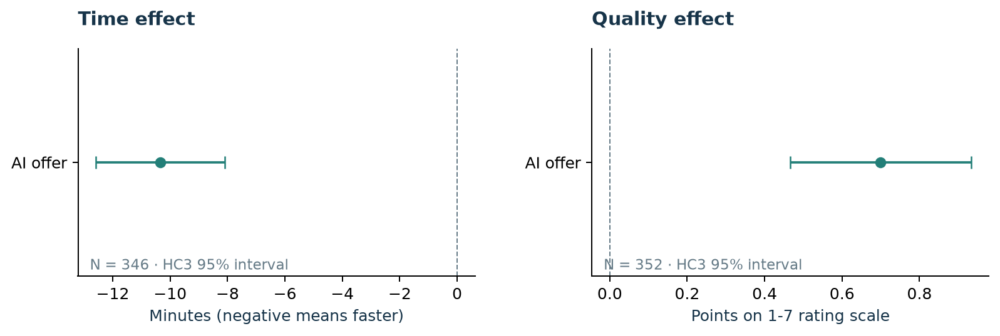
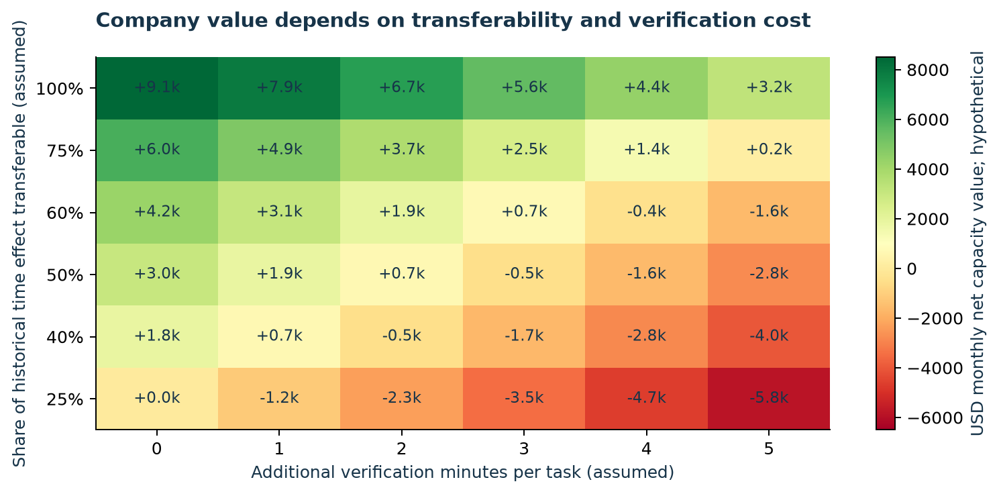

# Visual analysis gallery

Regenerate all eight figures with `make report` after `make run`. Charts are derived from aggregate results and are also used in the [research report](../reports/AIWorkValue_Research_Report.pdf).

| Figure | Decision question |
|---|---|
| [01 · Sample flow](01_sample_flow.png) | Which records support the estimates after documented exclusions? |
| [02 · Primary effects](02_primary_effects.png) | How large and uncertain are the time and quality assignment contrasts? |
| [03 · Before/after means](03_before_after_means.png) | How do unadjusted baseline and post-task averages differ by assignment? |
| [04 · Robustness](04_robustness.png) | Does the direction survive alternative estimators and outcome measures? |
| [05 · Heterogeneity](05_heterogeneity.png) | Do effects differ by baseline writing performance? These comparisons are exploratory. |
| [06 · Adoption](06_adoption.png) | Did assigned access change reported usage in the experiment and follow-up? |
| [07 · Business sensitivity](07_business_sensitivity.png) | When do transferability and additional verification change the investment case? |
| [08 · Commercial scenarios](08_commercial_scenarios.png) | How far apart are conservative, base and upside capacity-value outcomes? |

Experimental intervals describe historical available-case estimates. Scenario values are hypothetical, and released capacity is not measured cash savings. Original experiment and data: Noy and Zhang (2023).

## Task extension

The eight main figures are supplemented by a [weekly status-email chart](extensions/weekly_status_email.png), rebuilt with `make extension`. It varies task frequency and additional checking time while holding the other hypothetical inputs fixed. See the [case explanation](../reports/extensions/Weekly_Status_Email.md).
