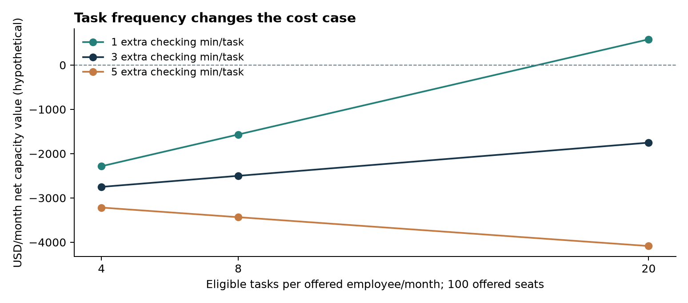

# Task extension: weekly project-status email

**Question:** would a paid AI tool cover its recurring cost if employees used it only to draft a weekly internal project-status email? This is a worked sensitivity exercise, not an email-writing experiment or an observed company outcome.

## What changed?

The original base case assumes 20 eligible tasks per offered employee/month and 2 extra checking minutes/task. This extension varies task frequency (4, 8, 20) and extra checking (1, 3, 5 minutes). Other configured costs and the assumed 50% transfer of the historical effect stay fixed. Four weeks and twenty working days are simplifying scenario conventions, not measured calendar averages. Higher frequencies represent a broader set of comparable status-writing tasks.

The assumed baseline task duration is 10 minutes. Gross transferred savings are capped at that duration, then reduced by review, 0.5 revision minutes and expected rework of 20% × 3 minutes. These are hypothetical incremental costs beyond the source-study workflow. The calculation charges all seat/support costs to this task and does not value other uses of a shared subscription. No email baseline or rework time has been measured here.

## Results

| Tasks/person/month | Extra checking minutes/task | Net capacity hours/month | Net capacity value/month |
|---:|---:|---:|---:|
| 4 | 1 | 20.5 | $-2,284 |
| 4 | 3 | 7.1 | $-2,750 |
| 4 | 5 | -6.2 | $-3,217 |
| 8 | 1 | 40.9 | $-1,567 |
| 8 | 3 | 14.3 | $-2,501 |
| 8 | 5 | -12.4 | $-3,434 |
| 20 | 1 | 102.3 | $581 |
| 20 | 3 | 35.7 | $-1,752 |
| 20 | 5 | -31.0 | $-4,085 |

## Why does the conclusion change?

A low-frequency task creates fewer opportunities to recover the monthly seat cost. More checking also reduces the useful minutes gained from each task. The recurring cost stays $3,000/month across these cases; 1 of 9 cases have positive net capacity value at the selected point estimate. A negative value does not mean writing becomes slower; it can mean that time value fails to cover the recurring bill.

With 4 tasks/month and 1 extra checking minute(s), the model gives **$-2,284/month net capacity value**. With 20 tasks and the same checking effort, it gives **$581/month**. Holding frequency at 20 but changing checking to 3 minutes gives **$-1,752/month**. These are conditional illustrations, not measured savings.

At 1 review minute(s), the operating break-even is 16.8 tasks per offered employee/month under these inputs. This excludes setup-cost recovery. The model permits negative net time when review/revision/rework outweigh the capped saving; it never predicts an AI workflow shorter than zero.

The CSV/JSON also carry ranges propagating only the historical time-effect interval. They do not capture uncertain transferability, task duration, frequency or cost allocation. No new statistical effect was estimated for email writing.

## What would be useful to measure next?

For one real writing workflow, record task frequency and full time to an acceptable result, including checking and rework. Use a simple quality rubric to prevent speed from masking worse output. Determine whether the tool would be purchased for this task alone or shared across other uses. These measurements have not been collected in this project.

## Reproduce and inspect

Run `make extension` from the project root; no participant data is required. Edit the [scenario configuration](../../data/scenarios/weekly_status_email.json), inspect the [SQL](../../sql/extensions/weekly_status_email.sql), or read the [exact JSON](weekly_status_email.json) and [CSV](weekly_status_email.csv). All nine SQL cases are checked against the Python capacity-value function. This extension was added after the historical main results were known.
